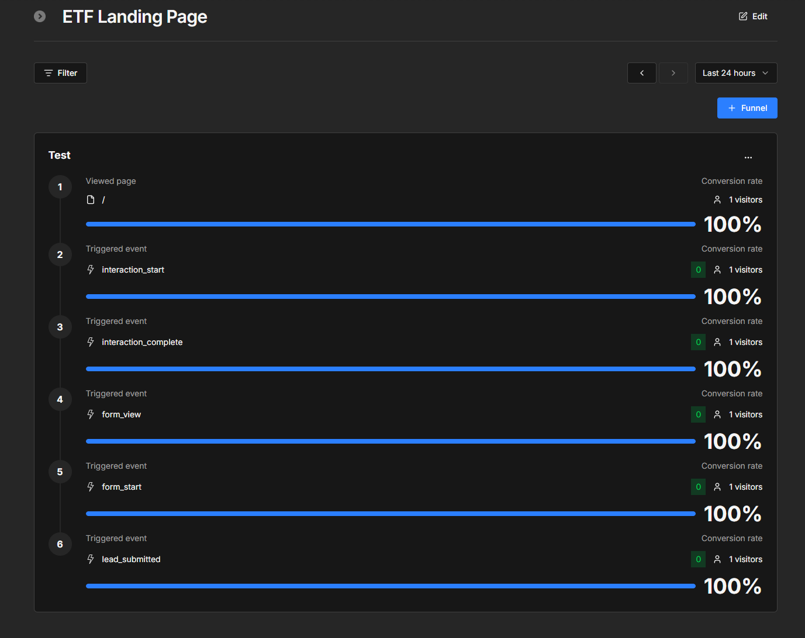

# ETF Dvojče: landing page pro českého drobného investora (Zadanie B)

**Živá stránka:** https://etf-landing-page-sigma.vercel.app
(reklama A: [`?utm_content=ad_a_blocked`](https://etf-landing-page-sigma.vercel.app/?utm_source=instagram&utm_medium=paid_social&utm_campaign=etf_dvojce_2026q4&utm_content=ad_a_blocked),
reklama B: [`?utm_content=ad_b_fees`](https://etf-landing-page-sigma.vercel.app/?utm_source=instagram&utm_medium=paid_social&utm_campaign=etf_dvojce_2026q4&utm_content=ad_b_fees))

**Obě reklamy:** [`ads/ad-a/`](ads/ad-a/) a [`ads/ad-b/`](ads/ad-b/) (obrázek 9:16 a 4:5, text, cílová URL s UTM).
**Export konverzací s Claude Code:** [`ai-log/`](ai-log/). **Podrobný deník práce s AI:** [`docs/ai-worklog.md`](docs/ai-worklog.md).

Stránka porovnává americká ETF, která lidé znají (VOO, SPY, QQQ…), s jejich evropskými „dvojčaty“ (UCITS fondy se
stejným indexem), spočítá poplatky v korunách a za e-mail pošle osobní plán s ISIN a daňovým checklistem.

---

## Obsah

1. [Klíčový poznatek, na kterém stojí koncept](#1-klíčový-poznatek-na-kterém-stojí-koncept)
2. [Cílová skupina](#2-cílová-skupina)
3. [Co návštěvník dostane a kdy žádáme o kontakt](#3-co-návštěvník-dostane-a-kdy-žádáme-o-kontakt)
4. [Pořadí sekcí a proč](#4-pořadí-sekcí-a-proč)
5. [Dvě verze reklamy](#5-dvě-verze-reklamy)
6. [Měření celé cesty](#6-měření-celé-cesty)
7. [Očekávaná konverze](#7-očekávaná-konverze)
8. [Tři hypotézy na A/B test](#8-tři-hypotézy-na-ab-test)
9. [Data a zdroje](#9-data-a-zdroje)
10. [Jak jsem pracoval s AI](#10-jak-jsem-pracoval-s-ai)
11. [Rozhodnutí, kde zadání nebylo jednoznačné](#11-rozhodnutí-kde-zadání-nebylo-jednoznačné)
12. [Technika, rychlost a testy](#12-technika-rychlost-a-testy)
13. [Co chybí a co bych dělal s více časem](#13-co-chybí-a-co-bych-dělal-s-více-časem)
14. [Co udělat před skutečným spuštěním reklam](#14-co-udělat-před-skutečným-spuštěním-reklam)
15. [Spuštění lokálně](#15-spuštění-lokálně)

---

## 1. Klíčový poznatek, na kterém stojí koncept

Český drobný investor si **u většiny brokerů americké ETF z NYSE (VOO, SPY, IVV…) nekoupí**. Nařízení PRIIPs
vyžaduje pro produkty prodávané drobným investorům dokument KID a americké fondy ho nevydávají. Výjimkou je Fio,
které americká ETF prodá bez poradenství (execution-only), což ČNB připouští (`data/sources.md` §1).

Člověk tedy vidí „VOO / S&P 500“ na YouTube nebo v reklamě, zkusí ho koupit a narazí na zeď. Proto stránka
neporovnává jen ETF z NYSE mezi sebou. Ke každému ukáže **evropské dvojče se stejným indexem**, které koupit může,
a řekne pravdu o rozdílech:

- daň z amerických dividend je **15 % v obou případech** (smlouvy ČR–USA a Irsko–USA), irský fond na dani
  neušetří;
- výhoda akumulační irské třídy je jinde: nic nevyplácí, takže **nic nepřiznáváte každý rok**, a **netýká se jí
  americká dědická daň** (nad 60 000 USD majetku v USA);
- irský *distribuční* fond je pro rezidenta ČR daňově nejhorší ze všech tří (`data/sources.md` §2.5).

Druhý příběh (reklama B) je bankovní akciový fond proti indexovému ETF: rozdíl v poplatcích za 20 let jsou
statisíce korun, s čísly z KID konkrétních fondů.

## 2. Cílová skupina

Podrobně v `docs/decisions.md` §1. Věk a chování jsou předpoklady pro plánování, ne data.

| | P1 „Zablokovaný začátečník“ (reklama A) | P2 „Spořič s bankovním fondem“ (reklama B) |
|---|---|---|
| Kdo | 24–35 let, zaměstnanec, spoří pevnou částku, v posledním roce si otevřel brokerskou aplikaci | 30–45 let, peníze na spořicím účtu nebo v podílovém fondu banky |
| Co zná | „S&P 500“, „VOO“ z YouTube a Redditu; ne „UCITS“ ani „domicil“ | Málo; slyšel, že ETF jsou „levnější“ |
| Kontext | telefon, prohlížeč uvnitř Instagramu, pár sekund pozornosti | telefon, feed Facebooku nebo Instagramu |
| Obavy | Je to pro mě legální? Vyberu ten správný? Daně? Nechce mi něco prodat? | Skryté poplatky, složitost, daně při prodeji |
| Úkol | „Řekněte mi ticker, který opravdu koupím, a proč je stejný.“ | „Ukažte mi v korunách, kolik mě stojí poplatky.“ |

Nechceme: aktivní tradery, profesionální klienty, hledače kryptoměn a tipů, lidi chtějící předpověď výnosů.

## 3. Co návštěvník dostane a kdy žádáme o kontakt

**Za kontakt:** *Váš ETF plán z Česka*, osobní plán e-mailem (`docs/decisions.md` §2, ukázka `docs/screenshots/email-*.png`):

1. **Vaše dvojčata s ISIN** pro každé vybrané americké ETF (ticker na Xetře i v Londýně, TER, akumulační či
   distribuční, měna fondu, zdroj a datum). ISIN zadáte u brokera a najdete přesně ten fond.
2. **Akumulační, nebo distribuční?** Tabulka pro rezidenta ČR: daň v USA, daň v ČR, papírování, dědická daň.
3. **Poplatky po letech v korunách:** bankovní fond proti ETF při vaší částce, i s poplatkem brokera a směnou měny.
4. **Daně z ETF v Česku 2026:** časový test 3 roky, limit 100 000 Kč z *celé částky prodeje*, co se změnilo
   1. 1. 2026, kdy patří dividendy do přiznání. Každé pravidlo s odkazem na zákon.
5. **Jak fond koupit:** obecný postup podle ISIN, bez žebříčku brokerů.

**Hodnota je vidět ještě před formulářem.** Po prvním ťuknutí na ticker stránka hned ukáže dvojčata (ticker, TER,
akumulační či distribuční) a rozdíl v poplatcích v korunách. Kdo odejde bez e-mailu, odchází s odpovědí. E-mail
přidá to, co stránka nemá: ISIN a burzovní tickery, daňovou tabulku, rozpis poplatků po letech a daňový checklist.

**Kdy o kontakt žádáme** (`docs/decisions.md` §3):

- **Nikdy při načtení.** Žádný popup ani exit-intent (v prohlížeči Instagramu stejně nefunguje).
- **Hlavní výzva:** hned pod prvním výsledkem nástroje, ve stejném bloku: „Chcete to celé, i s daňovým
  checklistem? Pošleme vám plán e-mailem.“ Tedy ve chvíli, kdy má návštěvník největší zájem.
- **Spodní lišta** „Poslat plán e-mailem“ se objeví až po první akci v nástroji a jen když formulář není vidět.
- **Záložní formulář** na konci stránky pro ty, kdo nástroj přeskočili (pošle plán pro S&P 500).

**Formulář má jedno pole:** e-mail. Zaškrtávátko „Chci občas dostat novinky o ETF“ je nepovinné a nezaškrtnuté.
Plán se posílá na základě žádosti (čl. 6 odst. 1 písm. b) GDPR); novinky jen se souhlasem (§ 7 zákona 480/2004 Sb.).
Proti spamu: skryté pole (honeypot), kontrola na serveru, jeden plán na adresu za 24 hodin, limit 10 odeslání
za 10 minut z jedné IP (Vercel Firewall).

**Po odeslání:** formulář nahradí poděkování „Hotovo. Plán je na cestě na …“ s nápovědou zkontrolovat spam,
celou tabulkou dvojčat s ISIN a tlačítkem pro sdílení odkazu (bez osobních údajů). Do minuty přijde e-mail
s plánem a tlačítkem „Otevřít plán online“ (`/plan`, vykreslený z parametrů v odkazu, bez databáze).
**Ověřeno 15. 10. 2026** do skutečných schránek: Gmail doručené, Seznam spam (důvod v bodě 14).

## 4. Pořadí sekcí a proč

| # | Sekce | Proč právě tady |
|---|---|---|
| 1 | **Úvod podle reklamy + nástroj hned na první obrazovce.** A: „Broker vám nedovolí koupit VOO? Má evropské dvojče.“ a tlačítka s tickery. B: „Kolik vás za 20 let stojí poplatky? Spočítejte si to v korunách.“ a posuvníky s výsledkem. | Návštěvník z reklamy dá stránce pár sekund. Prodlouží je jen odpověď na otázku, kterou reklama položila, proto první obrazovka opakuje slib reklamy slovo od slova a interakce *je* hlavní akce. Žádná fotka přes půl obrazovky. |
| 2 | **Nástroj ve třech krocích** (které ETF → kolik a jak dlouho → dividendy) **→ výsledek → výzva k e-mailu** | Hodnota dřív než žádost. Výzva přichází v okamžiku nejvyššího zájmu, ve stejném bloku jako výsledek. |
| 3 | **Proč vám VOO broker často neprodá** (3 fakta se zdroji) | Pro skeptika, který před ťuknutím scrolluje: vysvětlí, že nejde o chybu aplikace, a buduje důvěru. |
| 4 | **Co vám přijde e-mailem** (skutečný náhled e-mailu, ne „obálka e-booku“) | Konkrétně ukáže, co dostane, a znovu vyzve k odeslání. |
| 5 | **Kdo za tím stojí a odkud máme čísla** | Nový web bez historie: důvěru dávají zdroje, datum dat a „nejsme broker ani banka, nic neprodáváme“. |
| 6 | **Časté otázky** (zdarma? spam? doporučení? „Fio mi VOO koupit dovolí, co teď?“, daň při prodeji…) | Odstraní poslední námitky před odesláním. |
| 7 | **Záložní formulář + patička** (upozornění, minulá výkonnost, provozovatel, zásady) | Pro ty, kdo dočetli až sem bez nástroje. |

Varianty A a B mají stejné sekce; liší se nadpis, podnadpis a krok, na kterém se nástroj otevře (B má krok 1
sbalený na „Vybráno: VOO · změnit“). Variantu vybere malý skript v hlavičce ještě před vykreslením, takže nic
neposkočí. Bez JavaScriptu se ukáže varianta A a statická tabulka dvojčat; formulář funguje i bez JS.

## 5. Dvě verze reklamy

Meta (Instagram Stories 9:16 a Feed 4:5), statické obrázky. Podrobnosti, délky textů a vizuální zadání
v `content/ads.md`; hotové podklady v `ads/`.

| | A „Zablokovaný nákup“ | B „Poplatky v korunách“ |
|---|---|---|
| Persona | P1 | P2 |
| Obrázek | notifikace „Nákup nelze dokončit. Chybí dokument KID.“, přeškrtnuté VOO, překlápějící se tabulky s dosud nečitelným dvojčetem | „Kolik vás za 20 let stojí poplatky?“, dva pruhy ve skutečném poměru: bankovní fond 272 000 Kč, ETF 22 000 Kč |
| Nadpis | Evropské dvojče vašeho VOO | Poplatky za 20 let v korunách |
| Stránka se otevře na | kroku 1 (výběr ETF) | kalkulačce poplatků s předvybraným VOO |
| `utm_content` | `ad_a_blocked` | `ad_b_fees` |
| Soubory | [`ads/ad-a/`](ads/ad-a/) | [`ads/ad-b/`](ads/ad-b/) |

UTM schéma: `utm_source=instagram&utm_medium=paid_social&utm_campaign=etf_dvojce_2026q4&utm_content=…`.
Stránka z `utm_content` odvodí variantu (`ad_a_*` → a, `ad_b_*` → b, jinak `unknown`) a uloží ji ke kontaktu
v Brevo (`AD_VARIANT` + všech pět UTM), takže konverzi jde přiřadit ke konkrétní reklamě. Obrázky se generují
z HTML (`ads/src/ads.html`, `node ads/render.mjs`) se stejným písmem a barvami jako stránka.

## 6. Měření celé cesty

Podrobně v [`docs/readme-drafts/tracking.md`](docs/readme-drafts/tracking.md).

- **Umami Cloud** (EU region, bez cookies, skript 2,3 kB) měří cestu po stránce. Protože jeho skript posílá
  data z prohlížeče, podle EDPB (Guidelines 2/2023) a § 89 odst. 3 zákona 127/2005 Sb. na něj potřebujeme souhlas
  (`data/sources.md` §10). Lišta se souhlasem se ukáže nahoře až po prvním posunutí nebo ťuknutí, takže první
  obrazovku z reklamy nezakryje. Bez souhlasu se skript vůbec nestáhne.
- **Brevo** je zdroj pravdy pro konverze: každý lead je kontakt s `AD_VARIANT` a UTM, nezávisle na souhlasu.
- **Meta Ads Manager** dá počet prokliků na reklamu.

**Události:** `page_view` (s UTM v URL a variantou jako tag) → `section_view` → `interaction_start` →
`step_complete` (každý krok nástroje) → `interaction_complete` → `cta_click` → `form_view` → `form_start` →
`form_error` (s důvodem) → `lead_submitted` (**až po potvrzení serverem**) → `thank_you_view` → `magnet_opened`
(otevření `/plan` z e-mailu). Žádná událost nikdy nenese e-mail; `track()` zahodí každou s `@`.

**Ověřeno:** `node scripts/funnel-check.mjs` spustí skutečný skript Umami v prohlížeči a zkontroluje všechny
události a jejich pořadí (lokálně i proti živé URL, `docs/funnel-check*.log`). Trychtýř v Umami (6 kroků, okno 60 minut):



Jde jen o **testovací provoz z 15. 10. 2026** (automatické kontroly a test z mobilu). Snímek dokazuje, že všechny
kroky dorazí do Umami ve správném pořadí; procenta nejsou konverze. Umami navíc slučuje návštěvy ze stejného
zařízení a IP do jednoho návštěvníka, proto ukazuje 1. Před spuštěním se testovací data smažou (bod 14).

**Konverzní poměr varianty = leady v Brevo ÷ prokliky z Meta.** Umami vidí jen návštěvníky se souhlasem, proto
jeho trychtýř slouží k vysvětlení, kde lidé odpadají, ne k vyhlášení vítěze.

## 7. Očekávaná konverze

**Odhad: 4–6 % návštěv z reklamy odešle formulář, bodový odhad 5 %.** Je to můj úsudek, ne naměřená hodnota.
Podklady a výpočet v [`data/benchmarks.md`](data/benchmarks.md):

- **Výchozí bod:** medián landing pages v kategorii *investing* je **3,9 %** (Unbounce, 41 000 stránek, 2024).
  Finanční služby celkově mají medián 8,3 %.
- **Nahoru tlačí:** nabídka je zdarma a chce jen e-mail; hodnota je vidět před formulářem; kdo dojde k formuláři,
  už s nástrojem pracoval; ve finančních službách mobil konvertuje o 27,8 % lépe než desktop (Unbounce).
- **Dolů tlačí:** studený provoz z placených sociálních sítí v prohlížeči Instagramu s pár sekundami pozornosti;
  nová značka bez historie.
- **Prahy pro rozhodnutí:** pod 3 % po ~1 000 návštěvách na variantu = přepracovat; 8 % a víc = úroveň mediánu
  finančních služeb.
- Na proklik z Meta bude poměr o něco nižší než na návštěvu, protože část lidí odejde, než se stránka načte.

Tabulka konverzí z marketingového skillu (`lead-magnets`, „Finance 10–20 %“) nemá zdroj, proto jsem ji nepoužil
a nahradil ověřenými čísly z Unbounce, LocaliQ a Mailchimp.

## 8. Tři hypotézy na A/B test

Seřazené podle očekávaného dopadu. Podrobně, s metrikami a ochrannými metrikami, v
[`docs/readme-drafts/ab-tests.md`](docs/readme-drafts/ab-tests.md). Velikost vzorku počítá
`node scripts/sample-size.mjs` (α 0,05, síla 0,8). Varianty přiděluje reklamní systém, ne stránka (žádné
blikání); primární metrika je vždy leady v Brevo ÷ prokliky z Meta.

| # | Hypotéza | Proč takové pořadí | Vzorek na variantu (při 5 %) |
|---|---|---|---|
| 1 | **Úhel reklamy + vstupní krok:** „Broker vám nedovolí koupit VOO?“ s nástrojem na kroku 1 přinese jiný podíl leadů na proklik než „Kolik vás stojí poplatky?“ s kalkulačkou. | Mění publikum, slib i první obrazovku najednou. Řekne, který problém trh víc pálí, a podle toho se píše všechno ostatní. **Obě ramena jsou postavená** (reklamy A a B). | 3 780 (MDE 30 %) |
| 2 | **Hloubka brány:** když před formulářem ukážeme jen první dvojče a zbytek (všechna dvojčata, ISIN, poplatky po letech) pošleme e-mailem, vzroste podíl leadů u P1. | Mění, kolik hodnoty dáváme zdarma, tedy hlavní páku lead magnetu. Riziko: méně důvěry („schovávají to“), proto ochranná metrika `magnet_opened`. | 3 780 (MDE 30 %) |
| 3 | **Rámování nabídky:** nadpis výzvy „Pošleme vám daňový checklist“ místo „Pošleme vám plán“ zvýší podíl leadů. | Mění jednu větu, čekaný efekt je menší a test potřebuje zhruba dvojnásobek provozu. Má smysl až na vítězném úhlu z testu 1. | 8 158 (MDE 20 %) |

Při 300 proklicích denně (předpoklad) trvá test 1 a 2 asi 26 dní, test 3 asi 55 dní. Testy běží postupně, v celých
týdnech a nezastavují se dřív.

## 9. Data a zdroje

**Každé číslo na stránce i v e-mailu pochází ze staženého zdroje, ne z paměti modelu.** U čísel na stránce je
„Zdroj: …, stav k …“. Snímek dat je ze 9.–15. 10. 2026; jak ho obnovit, popisuje `data/sources.md`.

| Údaj | Soubor | Zdroj |
|---|---|---|
| Americká ETF a jejich UCITS dvojčata: ISIN, ticker na Xetře a v Londýně, TER, akumulační/distribuční, měna, index | `data/etfs.json` | factsheety a stránky vydavatelů (Vanguard, iShares/BlackRock, State Street SPDR, Invesco, Schwab), SEC; každé pole má `source_url`, `retrieved_at`, `as_of` |
| KID všech 13 dvojčat | `data/etfs.json`, `data/sources.md` §8 | dokumenty KID od vydavatelů, ověřené podle ISIN uvnitř PDF |
| Poplatky bankovních akciových fondů (vstupní 3–5 %, průběžné 1,75–2,59 %) | `data/bank-funds.json`, §5 | KID ČSOB Akciový (1. 6. 2026), KID KB Portfolio – Akciových indexů – Exclusive (24. 4. 2026), ceník ČS (1. 2. 2026) |
| Poplatky brokerů a směna měny | `data/brokers.json`, §7 | ceníky XTB (29. 4. 2026), Trading 212 (help centre), Fio (1. 7. 2026), Česká spořitelna (1. 2. 2026) |
| Kurz EUR/CZK | `data/fx.json` | API ČNB (`exrates/daily`), stahuje se při každém sestavení stránky |
| PRIIPs/KID, prodej amerických ETF, Fio | `data/sources.md` §1 | nařízení (EU) 1286/2014, ČNB RS2018-12 (odpověď B.2), stránky XTB, LYNX a Fio |
| Daň z dividend (15 %), daně v ČR, dědická daň USA | §2–4 | smlouvy ČR–USA a Irsko–USA (irs.gov), zákon o daních z příjmů (§ 4, § 8, § 16a, § 38g), Finanční správa, IRS (Form 706-NA), Irish Revenue |
| Předpoklad výnosu 5 % (nastavitelný 0–10 %) | §6 | pro srovnání UBS Global Investment Returns Yearbook 2026 (USA 6,6 % reálně, 1900–2025); záměrně nižší |
| Konverzní benchmarky | `data/benchmarks.md` | Unbounce, LocaliQ, Mailchimp |
| GDPR, souhlas s měřením | §9–10 | GDPR, zákon 480/2004 Sb., zákon 127/2005 Sb., EDPB Guidelines 2/2023, ÚOOÚ |

Každý záznam v `data/etfs.json` kontroluje `node data/validate.mjs` (kontrolní číslice ISIN, povinná pole, data,
zdroje, stejný index u dvojčat). Rozpory mezi zdroji a mezery jsou v `data/NOTES.md`. Výpočty poplatků na stránce
reprodukuje `content/calc-examples.mjs` a jsou pokryté testy.

## 10. Jak jsem pracoval s AI

Celý projekt jsem dělal v **Claude Code** (model Opus 5.5) po fázích, s mou kontrolou na konci každé fáze. Pravidla
pro agenta jsou v [`CLAUDE.md`](CLAUDE.md) (původní zadání je v něm doslova). Každý krok, každé použití skillu
a **každý prompt pro subagenta doslova** je v [`docs/ai-worklog.md`](docs/ai-worklog.md); exporty konverzací
v [`ai-log/`](ai-log/).

### Fáze a co v nich AI dělala

| Fáze | Co | Skilly / agenti |
|---|---|---|
| 0 Rozhodnutí | persony, lead magnet, kdy žádat o kontakt, nástroj, reklamy, pořadí sekcí, vizuál, stack | `product-marketing`, `lead-magnets`, `offers`, `frontend-design`; `/ponytail-audit` návrhu |
| 1 Data | ETF, daně, poplatky bank a brokerů, KID, benchmarky | žádný skill, jen dohledávání zdrojů (pravidlo: hodnoty jen ze staženého dokumentu) |
| 2 Texty | stránka, e-mail, reklamy, hlas zákazníka | `customer-research`, `copywriting`, `copy-editing`, `ads`, `ad-creative`, `emails` |
| 3 Stavba | Astro stránka, nástroj, formulář, `/api/lead`, e-mail, `/plan`, právní stránky | `writing-plans` → `subagent-driven-development`: **10 implementačních subagentů** (Haiku/Sonnet/Opus podle náročnosti), ke každému recenzent, na konci recenze celé větve |
| 4 Měření | události, souhlas, Umami, nasazení | `analytics`, `ab-testing`, `executing-plans`, `test-driven-development`; 1 nezávislý recenzent |
| 5 Nasazení + QA | Brevo, limit odeslání, Lighthouse, test na zařízení, odkazy, kontrola v reálných schránkách | `writing-plans`, `executing-plans`, `systematic-debugging`, `cro`, `/ponytail-review`, `verification-before-completion`; 1 nezávislý recenzent |

### Jaké pokyny agenti dostali

- **Trvalá pravidla v `CLAUDE.md`:** nikdy nepsat číslo z paměti; preferovat primární zdroje; u každého záznamu
  `source_url`, `retrieved_at`, `as_of`; žádná falešná sociální důkaznost, počítadla ani naléhavost; texty česky
  a přirozeně; TDD jen tam, kde je logika; nic neodstraňovat z měření, souhlasu, honeypotu ani přístupnosti;
  před účty, placenými službami a změnou konceptu se zeptat.
- **Subagenti (fáze 3)** dostali vždy: přesný text svého úkolu z plánu, kontext repozitáře, rozhodnutí vedoucího
  agenta k nejasnostem a povinnost reportovat stav (DONE / NEEDS_CONTEXT…). Recenzenti dostali úkol, rozsah diffu
  a pravidlo „jen číst, nic neměnit“. Příklad: prompt pro Task 1 a pro recenzi celé větve ve fázi 4 a 5 jsou
  v deníku doslova (sbalené bloky `<details>`).

### Jak jsem kontroloval výstup

- **Čísla:** skripty porovnávaly hodnoty v `data/` s textem stažených PDF a stránek (např. 13/13 fondů × 4 pole
  nalezeno ve factsheetech); validátor ISIN; každý dokument jsem kontroloval podle data uvnitř a podle ISIN.
- **Kód:** testy psané před kódem (84 testů, `npm test`), u každé opravy test, který nejdřív selhal; recenzenti
  bez kontextu autora; kontrola v reálném prohlížeči (Playwright), Lighthouse, kontrola odkazů.
- **Živá stránka:** událost přicházející do Umami, logy funkce na Vercelu, kontakty a odeslané e-maily v Brevo přes
  API, e-mail v reálné schránce Gmail a Seznam.
- **Texty:** citace zákazníků skriptem proti stažené diskusi (15/15 doslova), kontrola „AI frází“, moje čtení.

### Kde se AI mýlila (výběr; úplný seznam po fázích v deníku)

1. **Halucinace „ověření“:** v první verzi rozhodnutí agent napsal, že generický prompt mu „dal“ modrou mřížku
   karet. Žádný takový prompt nespustil. Přepsáno jako myšlenkový experiment.
2. **Čísla z paměti:** „index VTI má asi 3 700 akcií“, „QQQ je druhé nejžádanější ETF“, „Finance 10–20 %
   konverze“ (ze skillu bez zdroje). Vše zachyceno a nahrazeno citací, nebo vyřazeno.
3. **Chybný předpoklad konceptu:** první text tvrdil, že evropské dvojče je levnější a daňově výhodnější. Data
   ukázala, že daň z dividend je stejná (15 %); výhoda je jinde (akumulace, dědická daň). Koncept upraven.
4. **Špatný dokument:** odhadnuté ID stránky Vanguard otevřelo úplně jiný fond; první KID ČSOB byl konzervativní
   fond, ne akciový; „aktuální“ ceník XTB byl z roku 2021. Zachyceno kontrolou ISIN a data uvnitř dokumentu.
5. **Chybná citace zákona:** dividendy fyzických osob citovány přes § 20b, který je v části o dani právnických
   osob. Správně § 8 odst. 4 a 8.
6. **Tvrzení bez dat v textech:** „nejčastější ETF“, „funguje u každého brokera“, „Fio prodává“. Přepsáno
   (Fio „nenabízí“ ETF, jen umožní nákup).
7. **Únik osobního údaje:** agent jednou poslal můj e-mail v hlavičce požadavku na sec.gov bez dotazu. Nahlášeno,
   dál se neopakovalo.
8. **Chyby jen v prohlížeči:** událost `interaction_complete` se posílala o krok pozadu; testy to neodhalily,
   odhalil to až skutečný skript v Chromiu.
9. **Falešně zelený test:** první živá kontrola měření „prošla“, i když Umami nic neuložilo (odpovídá botům
   `{"beep":"boop"}`). Agent to našel porovnáním odpovědí a test zpřísnil.
10. **Posunutí obsahu (CLS):** záložní písmo bylo nastavené o třetinu větší, takže při načtení písma se celá
    stránka přeskládala. Agentův vlastní měřicí skript to nejdřív skryl filtrem; po opravě skriptu změřeno
    a opraveno (CLS 0,22 → 0,001).
11. **Server ve Washingtonu:** funkce `/api/lead` ve výchozím stavu běžela v USA (`iad1`), takže e-maily leadů
    putovaly přes USA. Přesunuto do Frankfurtu.
12. **Tichá ztráta leadů:** bez API klíče by produkce ukazovala „Plán je na cestě“ a nic neuložila. Teď vrací
    chybu. Při spuštění Brevo pak první skutečné odeslání selhalo (`401 Key not found`, chybný klíč ve Vercelu);
    diagnóza přes zpřesněný log, klíč nahrán z lokálního souboru bez zobrazení.

Co jsem rozhodl sám, ne AI: výběr person a obou úhlů reklam, všechny tři interaktivní prvky v jednom toku,
souhlasová lišta místo měření bez souhlasu, nejmenovat banku v reklamě B, kurz z ČNB, lišta nahoře.

## 11. Rozhodnutí, kde zadání nebylo jednoznačné

- **„ETF obchodovaná na NYSE“ pro českého investora:** porovnání jen ETF z NYSE by bylo pro většinu Čechů
  nepoužitelné (nekoupí je). Stránka proto začíná u nich a vede k evropským ekvivalentům. **QQQ se obchoduje na
  Nasdaqu,** ne na NYSE; ponechal jsem ho, protože ho lidé hledají, a texty říkají „americká ETF“, ne „ETF z NYSE“.
- **Které interaktivní prvky:** vybral jsem všechny tři navržené (porovnání fondů, kalkulačku poplatků, filtr), ale
  jako **jeden tok ve třech krocích** s jedním výsledkem a jednou výzvou, aby návštěvník neřešil tři widgety.
- **„Každý prvek má vést ke kontaktu“:** každý krok končí u stejného výsledku a výzvy; spodní lišta je na dosah
  z kteréhokoli místa po první akci.
- **Kvíz „vaše ETF“ jsem nahradil filtrem:** výstup „toto je vaše ETF“ by mohl působit jako investiční doporučení
  (MiFID II). Filtr a „Toto není doporučení“ zůstávají na straně informací.
- **Měření bez cookies stejně potřebuje souhlas** (§ 89 odst. 3 ZEK, EDPB), proto lišta a konverze z Brevo místo
  z Umami.
- **Bezplatný hosting:** Vercel Hobby, jak zadání navrhuje, i když jeho podmínky zakazují komerční použití; pro
  skutečný provoz viz bod 14.
- **Provozovatel:** skutečné údaje firmy neznám, na stránce jsou viditelně označená místa `[DOPLNIT …]`.

## 12. Technika, rychlost a testy

- **Astro** (statický web) + jeden malý ostrůvek v TypeScriptu pro nástroj; JavaScript při prvním načtení
  16,7 kB gzip (`npm run size`) (rozpočet 60 kB). Jedna funkce na Vercelu `/api/lead` (Frankfurt) → **Brevo** (kontakt + e-mail).
- **Lighthouse (mobil, simulované pomalé 4G, medián 3 běhů):** výkon, přístupnost i best practices **100** na
  všech čtyřech měřených stránkách, LCP 1,2–1,4 s, CLS 0 (`docs/qa/lighthouse.md`, HTML reporty vedle).
- **Emulovaný Android na škrceném 4G + vypnutý JavaScript:** `node scripts/qa-live.mjs` (8 stránek, LCP pod 1,1 s,
  žádné chyby v konzoli) → `docs/qa/qa-live.log`.
- **Odkazy:** `node scripts/check-links.mjs` kontroluje všechny stránky a všech zdrojů v `data/` (110 adres)
  → `docs/qa/links.log`, 0 nefunkčních.
- **Testy:** `npm test` (84 testů: výpočty poplatků, plán, validace vstupů, `/api/lead`, e-mail, měření),
  `node data/validate.mjs`, `node scripts/funnel-check.mjs`.
- **Přístupnost:** kontrast AA, dotykové plochy ≥ 44 px, popisky polí, hlavní sdělení i formulář fungují bez JS.

## 13. Co chybí a co bych dělal s více časem

- **Vlastní doména a ověřený odesílatel e-mailu.** Bez ní e-mail na Seznamu padá do spamu (bod 14). Je to první
  věc před spuštěním.
- **Test na skutečném iPhonu / Safari:** veškerá automatická QA běžela v Chromiu; mobil jsem testoval ručně
  podle `docs/qa/phone-checklist.md`.
- **Denní obnova kurzu ČNB:** workflow je připravené (`.github/workflows/fx-rebuild.yml`), ale na tomto projektu
  Vercel se nepodařilo vytvořit Deploy Hook, takže kurz se obnovuje při každém nasazení a stránka ukazuje jeho datum.
- **Varianty stránky pro A/B testy 2 a 3** zatím nejsou postavené (jen ramena testu 1).
- **Odhlášení z newsletteru** a obsah newsletteru: místo pro odkaz je označené `[DOPLNIT]`.
- **Hlas zákazníka** je z menšího vzorku (komentáře na Finhackeru a jinde); Reddit nešel automaticky přečíst.
- **Chybějící data:** průběžné náklady fondu České spořitelny (KID nebyl dostupný), kurzová přirážka Fio
  (nezveřejněná), DEGIRO a IBKR (bez oficiálního českého ceníku); vše v `data/NOTES.md`.
- **S více časem:** krátké video reklamy (Reels), druhý jazyk (slovenština), počítání `magnet_opened` i bez
  souhlasu na straně serveru, kontrola textů s právníkem a daňovým poradcem.

## 14. Co udělat před skutečným spuštěním reklam

Celý seznam se zdroji: [`docs/readme-drafts/launch-checklist.md`](docs/readme-drafts/launch-checklist.md).
Nejdůležitější body:

1. **Doplnit provozovatele** (jméno, IČO, sídlo, kontakt) na všech místech `[DOPLNIT …]`, včetně zásad ochrany
   údajů a odkazu pro odhlášení.
2. **Vlastní doména + ověření v Brevo (DKIM, DMARC).** Brevo neumí ověřit adresu na gmail.com nebo seznam.cz;
   testovací e-mail z adresy na email.cz skončil na Seznamu ve spamu, Gmail ho doručil s přepsaným odesílatelem.
3. **Přejít z Vercel Hobby** na Vercel Pro nebo Cloudflare Pages: Hobby je jen pro nekomerční použití.
4. **Reklamní pravidla Meta pro finanční služby** ověřit v Ads Manageru (výjimka pro reklamy, které produkt jen
   zmiňují a neprodávají; Google vyžaduje v Česku ověření inzerenta finančních služeb).
5. **Právník** potvrdí právní základ e-mailů a souhlasu s měřením (`data/sources.md` §9–10).
6. **Brevo:** vypnout automatické blokování neznámých IP (jinak po 30 dnech bez nové IP začne blokovat Vercel).
7. **Denní obnova kurzu** (Deploy Hook), **smazat testovací data** v Umami a Brevo, **znovu ověřit `data/`**,
   pokud je snímek starší než ~3 měsíce.

## 15. Spuštění lokálně

```bash
npm install
npx playwright install chromium   # jen pro skripty s prohlížečem
npm run dev                       # stránka + /api/lead (bez BREVO_API_KEY e-mail jen uloží do .dev/last-email.html)
npm test                          # 84 testů
npm run build                     # stáhne kurz ČNB do data/fx.json a sestaví web
node data/validate.mjs            # kontrola dat, vypíše OK
```

Proměnné prostředí: `.env.example`. Klíče jen v proměnných prostředí (Vercel Production), nikdy v repozitáři.

### Struktura

```
src/          stránka (Astro), nástroj, formuláře, měření; src/lib = logika s testy
api/lead.ts   jediná serverová funkce: validace, deduplikace, Brevo
data/         ETF, poplatky, kurz, zdroje (sources.md), benchmarky, poznámky
content/      schválené texty: stránka, e-mail, reklamy, hlas zákazníka
ads/          obě reklamy: obrázky 9:16 a 4:5, texty, cílové URL
docs/         rozhodnutí, deník práce s AI, plány, QA reporty, screenshoty, koncepty do README
ai-log/       exporty konverzací s Claude Code
scripts/      kontrola trychtýře, QA, odkazy, kurz ČNB, velikost JS, setup Brevo
```
